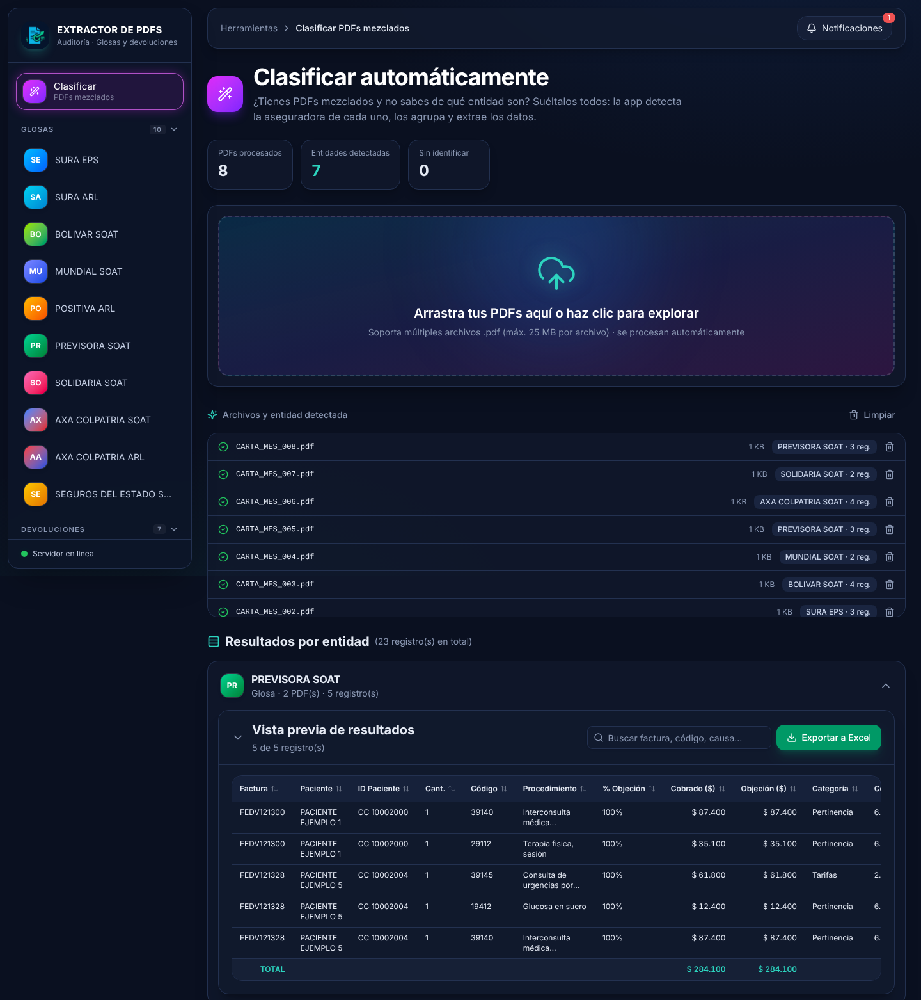
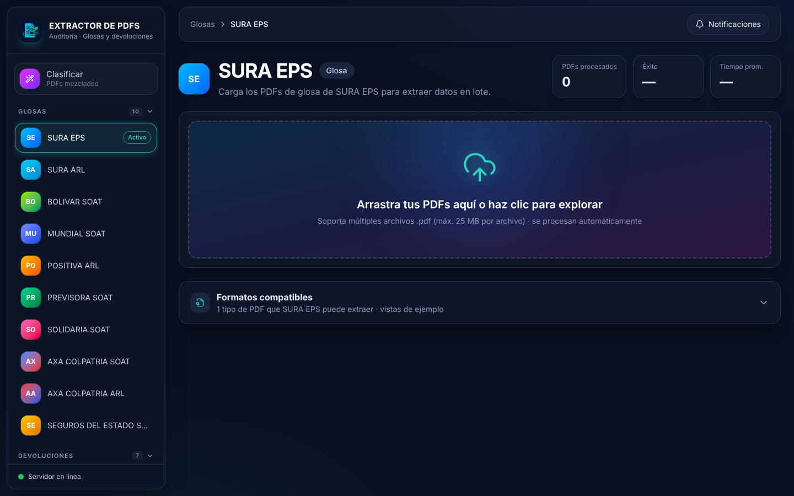

<h1 align="center">📄 Extracción de glosas y devoluciones</h1>

<b>Usted entrega la carpeta. La herramienta entrega el Excel.</b>

  <b>5 horas → 5 minutos</b> para consolidar 20 cartas · <b>2.900 PDFs</b> en validación · <b>1,2 s</b> por PDF

  

Capturas con datos de ejemplo ficticios.

---

## 😩 El problema

Cada mes, alguien en la IPS abre carta por carta de cada aseguradora y EPS, entiende
cómo viene armada y copia factura, código, valor y motivo a una hoja de cálculo.
Cada entidad usa un formato distinto, y un valor mal copiado termina en la
respuesta a la glosa y en la cartera.

## ✅ La solución

1. Arrastra los PDFs **tal como llegan**, aunque vengan mezclados.
2. La herramienta **reconoce sola la entidad** y si la carta es **glosa o devolución**.
3. Revisa los registros en pantalla y **exporta el Excel** de cada entidad.
4. Las cartas cuyo **total no cuadra** quedan marcadas para revisarlas.

> Prueba real: 30 cartas de Previsora SOAT en un solo lote, 293 registros extraídos,
> $ 100.008.590 en objeciones, 0 fallas.

## 🏥 Entidades compatibles

Sura EPS · Sura ARL · Bolívar · Mundial · Positiva · Previsora (glosas y devoluciones) ·
Solidaria · AXA Colpatria (SOAT y ARL) · Seguros del Estado

Agregar una entidad nueva solo requiere un extractor en el backend: el menú y las
tablas se arman solos.

## 🔒 Privacidad

Todo se procesa en el mismo computador. **Los PDFs no salen a internet.**

## 🛠️ Tecnología

| Capa | Herramientas |
|---|---|
| Backend | Python · FastAPI · pdfplumber · PyMuPDF · pypdf · openpyxl |
| Frontend | React · Vite · Tailwind · componentes estilo shadcn/ui |
| Distribución | Ejecutable portable para Windows (PyInstaller), sin instalar nada |

## 🚀 Pruébala

Versión portable para Windows 10/11: se descomprime y se abre, sin instalar Python ni nada más.
Escríbenos y te enviamos la versión de prueba para usarla con tus propias cartas.

## 📬 ¿La quieres en tu IPS?

Escríbenos a **[nexxtiasoluciones@gmail.com](mailto:nexxtiasoluciones@gmail.com)** y agendamos una demo con tus propias cartas.
